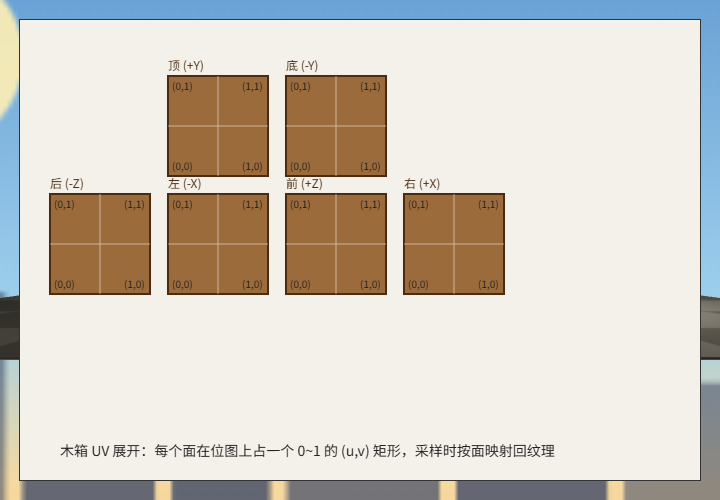
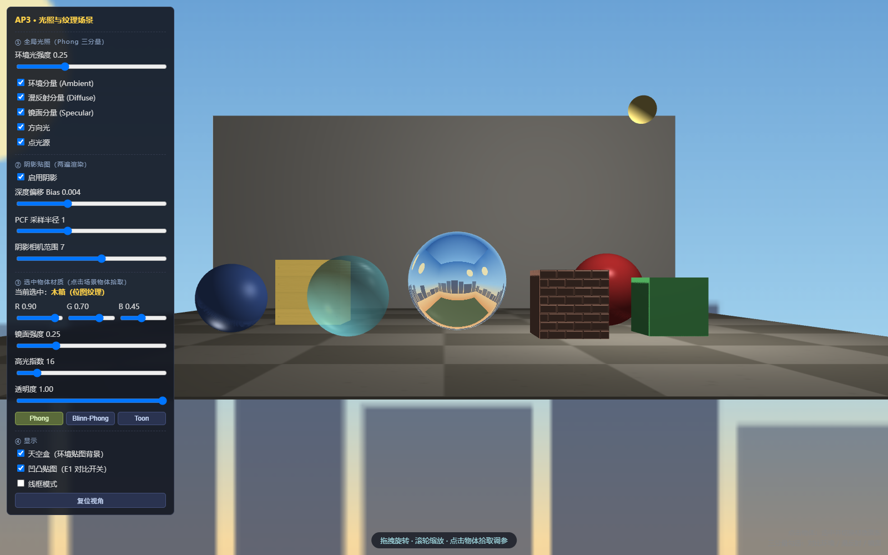
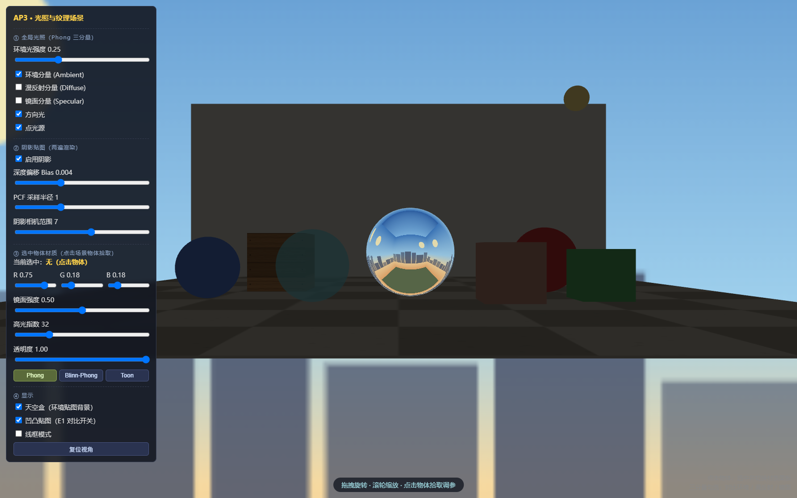
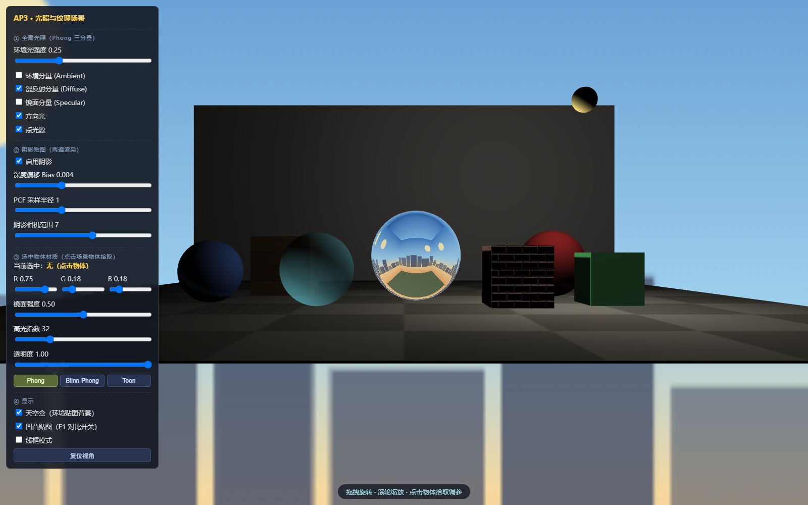
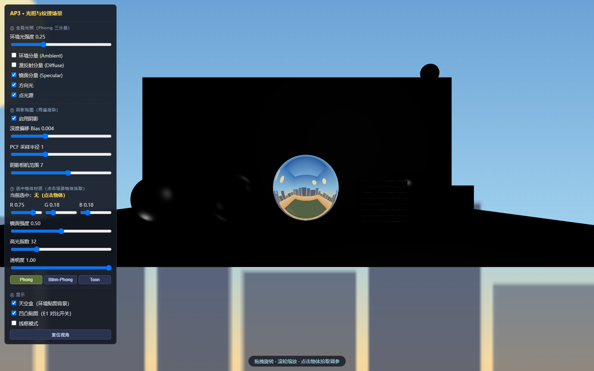
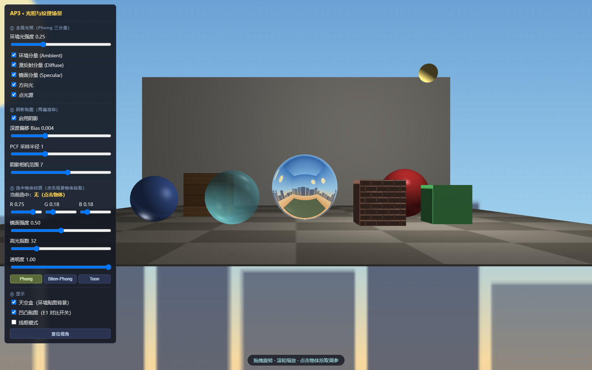

# AP3 · 光照与纹理场景

| 项目 | 内容 |
| --- | --- |
| 课程 | 计算机图形学 AP3 光照与纹理场景 |
| 姓名 | 张容畅 |
| 学号 | 2406100329 |
| 班级 | 软件 241 |
| 技术栈 | 原生 WebGL 2.0 + 原生 JavaScript（无构建步骤、无第三方库） |
| 工具库 | 教材配套 `Common/initShaders.js`、`Common/MV.js`、`Common/webgl-utils.js` |

本工程实现了一个带方向光与点光源的房间场景，包含 Phong 着色、位图纹理、环境反射贴图、阴影贴图与物体拾取调参，并附带凹凸贴图、透明混合、Blinn-Phong / Toon 着色等选做扩展。

---

## 一、运行方式

工程为纯静态站点，**不要直接双击 `index.html`**（浏览器对 `file://` 下的纹理 / FBO 加载有限制），需通过任意静态 HTTP 服务器访问。

任选其一：

```bash
# 方式一：Python（已安装 Python 3）
cd 工程目录
python -m http.server 8123
# 浏览器打开 http://localhost:8123/index.html
```

```bash
# 方式二：Node（已安装 Node）
npx serve .
# 按终端提示给出的地址打开
```

公网部署：将本目录推送到 GitHub 仓库，在仓库 **Settings → Pages** 中选择分支与根目录启用 GitHub Pages，即可通过公网 URL 直接访问。

---

## 二、目录结构

```
张容畅-2406100329-软件241-AP3/
├── index.html              # 页面、参数面板与脚本入口
├── README.md               # 本说明文档
├── URL.txt                 # 公网访问地址与部署说明
├── Common/                 # 教材配套工具库（未改动）
│   ├── MV.js               # 矩阵 / 向量运算（列主序 mat4）
│   ├── initShaders.js       # 着色器编译、链接与 uniform 定位
│   └── webgl-utils.js       # Canvas 尺寸自适应等工具
├── js/
│   ├── shaders.js          # 四套 GLSL 源码：Phong 主程序 / 深度程序 / 天空盒 / 拾取程序
│   ├── geometry.js         # 球体、立方体、天空盒几何生成（位置 / 法线 / UV / 索引）
│   ├── textures.js         # Canvas 程序化纹理：木纹、棋盘、砖墙凹凸、六面 cubemap、UV 示意图
│   ├── scene.js            # 光源与物体配置（几何、位置、材质集中管理）
│   ├── shadow.js           # 阴影贴图 FBO 封装（深度纹理 + 光空间矩阵）
│   ├── pick.js             # 颜色编码拾取离屏 FBO 封装
│   ├── camera.js           # 四元数轨迹球相机（拖拽旋转 / 滚轮缩放）
│   ├── ui.js               # 面板控件绑定与选中物体材质回填
│   └── main.js             # 主循环、两遍渲染、场景图绘制、拾取调度、URL 参数解析
└── screenshots/            # README 引用的演示截图
```

代码按 **场景配置 / 着色器 / 几何 / 纹理 / 阴影 / 拾取 / 相机 / UI / 主程序** 分文件组织，各模块职责独立。

---

## 三、交互说明

| 操作 | 效果 |
| --- | --- |
| 鼠标拖拽 | 轨迹球旋转视角 |
| 滚轮 | 缩放相机距离 |
| 点击场景中可拾取物体 | 颜色编码拾取，物体高亮（金色描边式混合），面板回填该物体材质参数 |
| 面板「环境 / 漫反射 / 镜面」勾选 | 独立开关 Phong 三分量，实时对比 |
| 环境光强度滑杆 | 调节环境分量整体强度 |
| 方向光 / 点光源勾选 | 开关对应光源 |
| 深度偏移 Bias | 调节阴影深度偏移，观察阴影 acne（条纹）与 Peter-panning（悬浮） |
| PCF 采样半径 | 调节阴影边缘柔和度（3×3 邻域加权） |
| 阴影相机范围 | 调节正交阴影相机半范围，观察阴影分辨率与覆盖范围变化 |
| 选中物体后 R/G/B、镜面强度、高光指数、透明度 | 实时修改该物体材质 |
| Phong / Blinn-Phong / Toon 按钮 | 切换选中物体的着色模型 |
| 凹凸贴图勾选 | 开关砖墙凹凸效果，对比有 / 无 bump 的表面明暗 |
| 线框模式 | 以线框方式查看几何拓扑 |
| 复位视角 | 回到默认相机姿态 |

可拾取物体：木箱、反射球、Phong 红球、玻璃球、砖墙、Toon 盒、Blinn-Phong 球；地面、后墙、点光源小球不可拾取。

---

## 四、实现要点

### 4.1 场景与光源

场景共 10 个物体（地面、后墙、木箱、反射球、Phong 红球、玻璃球、砖墙、Toon 盒、Blinn-Phong 球、点光源小球），2 个光源：

- **方向光**（暖白色，位置 `[6, 9, 4]`，指向原点）：投射阴影贴图；
- **点光源**（冷蓝色，位置 `[2.6, 3.0, 2.2]`）：带距离衰减，不投射阴影。

地面与后墙为阴影接收面；可投影物体在第一遍深度渲染中写入阴影贴图。

### 4.2 Phong 着色模型（三分量）

片元着色器按经典 Phong 模型合成颜色：

```
C = C_ambient + C_diffuse + C_specular

C_ambient  = I_ambient * Ka
C_diffuse  = Kd * (N·L) * I_light
C_specular = Ks * (R·V)^n * I_light
```

其中以下参数均以 uniform 暴露并由面板实时调节：

| Uniform | 含义 | 面板控件 |
| --- | --- | --- |
| `uAmbientIntensity` | 环境光强度 | 环境光强度滑杆 |
| `uDiffuseColor` | 漫反射颜色 Kd（RGB） | 选中物体 R/G/B 滑杆 |
| `uSpecularStrength` | 镜面强度 Ks | 镜面强度滑杆 |
| `uShininess` | 高光指数 n | 高光指数滑杆 |

环境、漫反射、镜面三个分量分别由 `uUseAmbient` / `uUseDiffuse` / `uUseSpecular` 独立勾选开关，便于逐分量对比。方向光与点光源各自计算后叠加。

### 4.3 位图纹理与 UV 数据流

木箱使用程序化生成的木纹位图，地面使用棋盘位图。完整数据流如下：

1. **顶点 UV**：几何生成时为每个顶点写入二维纹理坐标 `(u, v) ∈ [0,1]`，作为顶点属性 `aTexCoord` 上传；
2. **attribute 传递**：顶点着色器接收 `aTexCoord`，经插值后以 `vTexCoord` 传给片元着色器；
3. **位图上传**：Canvas 绘制的图像通过 `gl.texImage2D` 上传为 2D 纹理，设置环绕方式与过滤方式；
4. **片元采样**：片元着色器用 `texture2D(uTex, vTexCoord)` 按插值 UV 采样纹素，与漫反射颜色相乘得到表面颜色。

木箱六面在纹理图上的展开方式与角点 UV 标注见下图：



每个面在位图上占一个 `0~1` 的 `(u, v)` 矩形，几何面按自身 UV 把纹理映射回三维表面；相邻面共享同一张位图，UV 坐标决定了纹素落在表面的位置。

### 4.4 环境贴图（反射映射）

反射球使用六面 cubemap 环境贴图（教材 7.6 Reflection Mapping）：

- 六个面由 Canvas 程序化生成天空与楼块背景；
- 片元着色器由视线方向与法线计算反射向量 `R = reflect(V, N)`；
- 以反射向量方向在 cubemap 上采样环境颜色，按反射率 `reflectivity` 与自身漫反射色混合。

环境反射分支独立于 Phong 三分量，因此在关闭漫反射 / 镜面的对比图中，反射球仍显示环境倒影。

### 4.5 阴影贴图（两遍渲染）

阴影贴图按教材 Ch8.8 的两遍渲染流程实现：

**第一遍（深度遍）**：以方向光为视点，用正交投影矩阵把场景中可投影物体渲染到一张 1024×1024 的深度纹理（FBO，`DEPTH_COMPONENT24`，无颜色附件）。该遍只写入片元在光空间的深度，不输出颜色。

**第二遍（主渲染遍）**：正常相机渲染场景。对每个接收阴影的片元：

1. 用「光空间观察·投影矩阵」把片元世界坐标变换到光空间，归一化到 `[0,1]` 得到投影坐标 `(s, t, d)`；
2. 在深度纹理的 `(s, t)` 处采样最近物体深度 `d_light`；
3. 比较片元深度 `d` 与 `d_light`：若 `d - bias > d_light`，说明片元在阴影中，阴影系数取 0；否则取 1；
4. 采用 3×3 PCF 邻域加权平滑阴影边缘。

面板可调参数与对应的常见现象：

- **Bias 深度偏移**：过小会出现阴影 acne（表面条纹状伪影），过大则物体阴影与表面分离（Peter-panning）；
- **PCF 半径**：控制阴影边缘柔化程度；
- **阴影相机范围**：范围越大，同一深度纹理覆盖的场景越大，单位面积分辨率越低，阴影越容易出现锯齿。

### 4.6 颜色编码拾取

拾取采用离屏颜色编码方案（与射线求交二选一，本工程选用颜色编码）：

1. 为每个可拾取物体分配唯一整数 ID（从 1 起，背景为 0）；
2. 点击时把场景在独立的离屏 FBO（RGBA8 + 深度缓冲）中重绘一遍：拾取程序把物体 ID 编码到颜色通道 `(r, g, b) = (id & 0xFF, (id >> 8) & 0xFF, (id >> 16) & 0xFF)`，不绘制光照与纹理；
3. `readPixels` 读取点击像素颜色，解码还原物体 ID；因 `readPixels` 原点在左下角，读取时做 Y 翻转；
4. 命中后将该物体置为选中状态（高亮），并把其材质参数回填到面板，后续滑杆直接修改该物体。

点击事件先判断轨迹球是否发生拖拽，拖拽结束后的松手不触发拾取，避免旋转视角时误选。

拾取后效果如下图：木箱被高亮，面板显示其名称与材质参数。



---

## 五、Phong 三分量对比截图

| 组合 | 截图 | 现象 |
| --- | --- | --- |
| 只环境分量 |  | 表面为基色 × 环境光的平涂颜色，无明暗过渡、无高光 |
| 只漫反射分量 |  | 呈现朗伯明暗：朝光面亮、背光面暗，但无高光斑 |
| 只镜面分量 |  | 表面大面积为黑，仅在视线反射方向出现高光斑 |
| 三分量全开 |  | 环境打底 + 漫反射明暗 + 镜面高光，完整 Phong 效果 |

全开全景：



---

## 六、选做扩展

| 编号 | 扩展 | 实现位置 |
| --- | --- | --- |
| E1 | 法线 / 凹凸贴图对比：砖墙使用程序化砖墙凹凸灰度图，按扰动后的法线计算明暗；面板「凹凸贴图」勾选可一键开关对比 | `js/textures.js`（砖墙 bump 图）、片元着色器 bump 扰动、面板 `ui-bump` |
| E2 | 透明物体混合：玻璃球 `gl.blendFunc(SRC_ALPHA, ONE_MINUS_SRC_ALPHA)`，关闭深度写入按半透明混合 | 主程序透明物体绘制分支、`mat.opacity` |
| E3 | Blinn-Phong 与 Toon 着色对比：同场景并排 Blinn-Phong 球（半程向量 `H = normalize(L+V)`）与 Toon 盒（漫反射离散分级），面板可切换着色模型 | 片元着色器 `uShadingModel` 分支、`js/scene.js` |

---

## 七、参考与引用

- `Common/MV.js`、`Common/initShaders.js`、`Common/webgl-utils.js` 为课程教材配套工具库，原样复用，未作改动；
- 轨迹球相机思路参考教材与课程 AP2 作业的四元数轨迹球实现；
- 阴影贴图两遍渲染、cubemap 反射映射、PCF 采样对应教材第 7、8 章相关算法；
- 场景几何、着色器源码、材质配置、纹理生成、阴影 / 拾取封装与 UI 绑定均为本工程独立撰写；
- 所有位图与 cubemap 均由 Canvas 程序化生成，未使用外部版权贴图。

---

## 八、附：URL 调试参数

页面支持查询参数，便于现场演示与截图复现（正式演示直接用默认地址即可）：

| 参数 | 取值 | 作用 |
| --- | --- | --- |
| `ambient` / `diffuse` / `specular` | `0` / `1` | 三分量初始开关 |
| `az` / `el` / `dist` | 数值 | 初始相机方位角 / 仰角 / 距离 |
| `debug` | `1`~`4` | 调试可视化：1 UV、2 深度纹理、3 阴影系数、4 光空间投影 UV |
| `select` | 物体 ID | 初始选中指定物体（拾取演示截图） |
| `uvd` | `1` | 铺满输出 UV 展开示意图（README 配图导出） |

示例：`index.html?ambient=1&diffuse=0&specular=0` 即只开环境分量。
